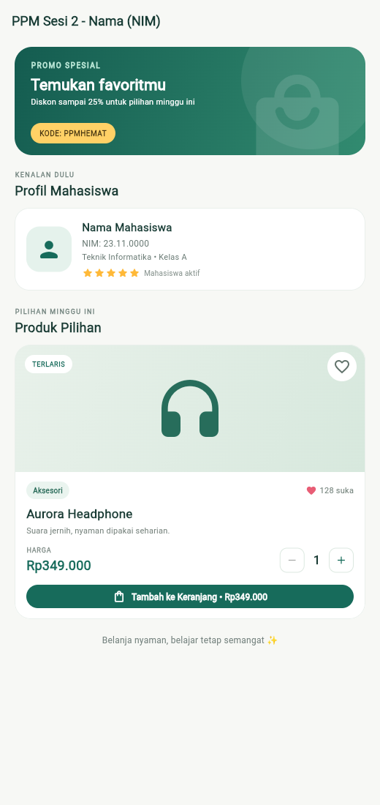

# Product & Profile — PPM Sesi 2

Aplikasi Flutter sederhana untuk menampilkan profil mahasiswa dan kartu produk
interaktif. Dibuat menggunakan widget Material bawaan Flutter, tanpa dependensi
tambahan.

## Screenshot



## Fitur

- Kartu profil mahasiswa dengan ikon profil dan lima bintang.
- Banner promo dengan `Stack` dan `Positioned`.
- Kartu produk dengan kategori, harga, dan placeholder ilustrasi produk.
- Favorit interaktif dengan jumlah suka yang bertambah atau berkurang.
- Pengatur kuantitas (minimal satu) dan total harga yang diperbarui langsung.
- Tombol tambah ke keranjang yang menampilkan `SnackBar`.

## Menjalankan aplikasi

```bash
flutter pub get
flutter run
```

Untuk menjalankan pengujian widget:

```bash
flutter test
```

## Personalisasi profil

Sebelum dikumpulkan, ganti teks `Nama Mahasiswa`, `23.11.0000`, dan
`Teknik Informatika • Kelas A` di `lib/main.dart` dengan identitas mahasiswa.
Judul AppBar dapat disesuaikan pada baris `PPM Sesi 2 - Nama (NIM)` di file yang
sama.
